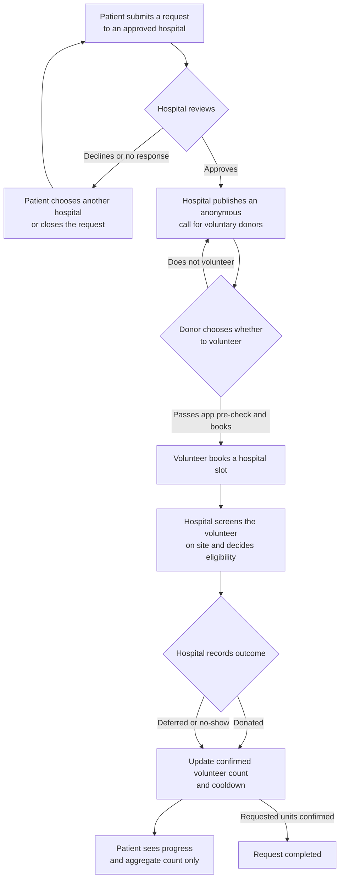

# Lifeline process flow

## Swimlane description

### Patient

1. Selects an approved, active hospital, blood type, units, and urgency, and
   acknowledges the voluntary/unpaid notice.
2. Sends the request to that hospital. It remains in hospital review; it is
   not visible as an open call to donors.
3. Sees the hospital's decision, request progress, and an aggregate count of
   confirmed volunteer appointments. If the hospital declines or times out,
   the patient may choose another hospital or close the request.
4. Does not see volunteer names, contact details, pre-check answers, or
   appointment records.

### Hospital

1. Reviews incoming patient requests, with emergencies ordered first, and
   approves or declines with an optional note.
2. For an approved request, publishes appointment times and coordinates the
   anonymous call for voluntary donors.
3. Communicates with the patient and booked volunteers only through the
   hospital-scoped in-app conversations.
4. Screens volunteers in person and records Donated, Deferred, or No-show.
   A recorded donation updates the aggregate progress and donor cooldown.
5. Reviews relevant reports and audit history. Lifeline does not make clinical
   eligibility decisions or record blood collection/testing details.

### Donor

1. Gives the required voluntary/unpaid consent and sees calls matching their
   blood type after hospital approval.
2. May complete the non-clinical self-check and select an available hospital
   appointment. The check is not medical clearance.
3. May cancel a scheduled appointment; the place becomes available again.
4. Attends the hospital, where staff perform all screening and decide whether
   to proceed. The donor and patient never see or message one another.
